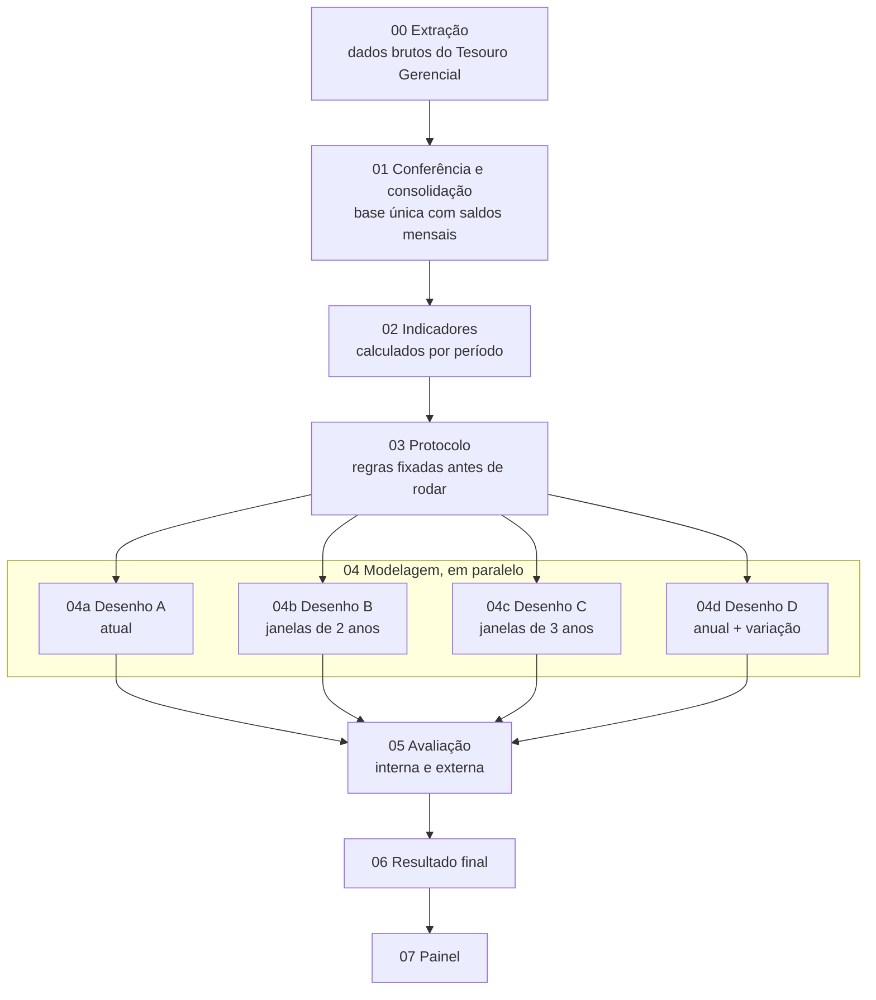

# Detecção de anomalias contábeis para priorização de auditorias em universidades federais

Repositório da pesquisa de mestrado de Nelson G. S. Ramos no Mestrado Profissional em Controle da Administração Pública do Instituto Serzedello Corrêa (ISC/TCU), Linha 2 (Tecnologias para Inovação do Controle Governamental), sob orientação do Prof. Dr. Remis Balaniuk.

A pesquisa usa os dados das próprias demonstrações contábeis para ordenar as universidades federais segundo o risco de distorção contábil, sem depender de casos de distorção previamente confirmados. O resultado é um critério de priorização para o planejamento de auditorias e não constitui juízo de irregularidade.

## Problema de pesquisa

> Como o controle externo pode identificar, entre unidades jurisdicionadas de uma mesma categoria, aquelas com maior risco de distorção contábil, a partir dos dados das próprias demonstrações e sem casos de distorção previamente confirmados?

As universidades federais relacionadas na Portaria-TCU nº 58/2025 são o caso estudado.

## Situação atual

O repositório está na **Versão 3**, em desenvolvimento no ramo `versao-3`. O ramo `main` e o [painel publicado](https://pipelineprojetomestrado-5fthcuwmapxgk5ymjo99wl.streamlit.app/) continuam na Versão 2 até a Versão 3 ficar pronta.

| Etapa | Pasta | Situação |
| --- | --- | --- |
| 0. Extração | `00_extracao` | Concluída: 2016 a 2025 extraídos (os zips anuais entram no repositório em seguida) |
| 1. Conferência e consolidação | `01_conferencia_e_consolidacao` | Concluída em 13/11/2026: conferência sem falhas e base consolidada gerada (a base entra no repositório em seguida) |
| 2. Indicadores | `02_indicadores` | A fazer |
| 3. Protocolo de experimentos | `03_protocolo` | A fazer |
| 4. Modelagem | `04a` a `04d` | A fazer |
| 5. Avaliação | `05_avaliacao` | A fazer. O levantamento dos registros de controle pode começar em paralelo |
| 6. Resultado final | `06_resultado_final` | A fazer |
| 7. Painel | `07_painel` | A fazer. A Versão 2 continua publicada |

## Visão geral do fluxo

As pastas são numeradas na ordem em que são usadas. Cada etapa só lê das pastas anteriores e só grava na própria pasta, de modo que a numeração mostra o caminho dos dados. Os quatro desenhos de modelagem (04a a 04d) são feitos em paralelo e por isso compartilham o mesmo número.



## Estrutura de pastas

```
pipeline_projeto_mestrado/
├── README.md
├── requirements.txt
├── 00_extracao/
│   ├── sql/                           consulta de extração e diagnósticos
│   └── dados_brutos/                  exportacao_2016.zip ... exportacao_2025.zip
├── 01_conferencia_e_consolidacao/
│   ├── relatorio_qualidade.xlsx
│   └── base_consolidada/              movimentos, saldos mensais e nomes
├── 02_indicadores/
├── 03_protocolo/
├── 04a_desenho_A_atual/
├── 04b_desenho_B_janelas_2_anos/
├── 04c_desenho_C_janelas_3_anos/
├── 04d_desenho_D_anual_delta/
├── 05_avaliacao/
│   ├── interna/
│   ├── externa/
│   └── comparacao_desenhos/
├── 06_resultado_final/
├── 07_painel/
├── src/                               funções usadas por várias etapas
└── versoes_anteriores/
    ├── Versao_1/
    └── Versao_2/
```

| Pasta | Entrada | Processo | Saída |
| --- | --- | --- | --- |
| `00_extracao` | Banco do Tesouro Gerencial | Consulta SQL executada no SQuirrel, um ano por vez | Um zip por ano, de 2016 a 2025 |
| `01_conferencia_e_consolidacao` | Zips de `00_extracao` | Conferências contábeis e consolidação | Relatório de qualidade e base consolidada em parquet |
| `02_indicadores` | Base consolidada | Cálculo dos indicadores para cada período de cada desenho | Matrizes de indicadores e dicionário |
| `03_protocolo` | Decisões de método | Definição das regras e das configurações antes de rodar | Protocolo e arquivo de configurações |
| `04a` a `04d` | Indicadores e protocolo | 5 modelos e consenso, para cada configuração | Rankings, votos, escores e explicações |
| `05_avaliacao` | Resultados dos desenhos e registros de controle | Avaliação interna, avaliação externa e comparação | Métricas de cada desenho e escolha do desenho final |
| `06_resultado_final` | Desenho escolhido | Ranking final, explicações e testes de sensibilidade | Tabelas e gráficos finais |
| `07_painel` | Resultado final | Painel interativo em Streamlit | Painel publicado |
| `src` | Usada por todas as etapas | Funções de leitura, conferência, indicadores, modelos e avaliação | Código comum, escrito uma única vez |

Cada pasta de etapa terá um notebook curto que chama as funções de `src` e guarda os resultados na própria pasta. Assim, quem abre a pasta vê o processo e o resultado daquela etapa, e o código comum fica num lugar só.

## Universo e período

A análise principal cobre **44 universidades**, de **2017 a 2025**, com **2016** como ano base. Cada desenho também roda numa versão só com as **39 universidades** que têm dados em todos os anos.

| Grupo | Universidades | Anos na análise |
| --- | --- | --- |
| Antigas | 39 universidades, códigos de 26231 a 26450 | 2017 a 2025 (2016 como base) |
| Novas | UFCAT (26452), UFJ (26453), UFR (26454), UFDPar (26455) e UFAPE (26456) | 2021 a 2025 (2020 excluído: primeiro exercício, sem saldo de abertura) |
| Excluída | UFNT (26457) | Nenhum. Entra só num teste de sensibilidade com 2024 e 2025 |

Motivos das regras:

1. **Período.** 2016 é o primeiro exercício disponível na base do Tesouro Gerencial e já segue integralmente o Plano de Contas Aplicado ao Setor Público (PCASP), implantado no SIAFI em 2015. Os testes mostraram mês de abertura, mês de encerramento e continuidade de saldos entre exercícios a partir de 2016.
2. **Primeiro exercício.** Fica fora o primeiro exercício de existência de cada universidade como órgão, que não tem saldo de abertura (mês 0). Em 2020, o patrimônio das universidades novas foi formado ao longo do ano, e o volume de lançamentos ficou em torno da metade do normal. Por isso, os indicadores de saldo e a variação entre anos do desenho D não teriam uma base comparável. Elas tiveram movimento nos 12 meses de 2020; a UFNT, só em novembro e dezembro.
3. **UFNT.** A implantação se estendeu de 2021 a 2023, com volume anual de lançamentos entre 13% e 35% do volume de 2025. Seus alertas seriam explicados pela implantação, e não pela contabilidade. Por ser a primeira colocada da Versão 2, um teste de sensibilidade mostra o efeito da retirada.

## Etapas

### Etapa 0. Extração (`00_extracao`)

Os dados são o movimento líquido mensal por conta contábil, extraído do banco do Tesouro Gerencial com o programa SQuirrel.

- **Consulta:** `sql/extracao_mestrado_v2.sql`, executada uma vez para cada ano, de 2016 a 2025.
- **Filtros:** as 45 universidades e as classes 1, 2, 3, 4, 6 e 8 do PCASP.
- **Nível de detalhe:** ano, mês, universidade, UG executora, conta contábil, grupo e elemento de despesa.
- **Meses:** todos. O mês 0 é a abertura do exercício (saldo inicial), os meses 1 a 12 são o ano civil, o mês 13 é o encerramento e o mês 14 é um mês adicional do SIAFI.
- **Arquivos:** `dados_brutos/exportacao_AAAA.zip`, cada um com o CSV do ano. Os CSVs descompactados não vão para o GitHub.

O saldo das contas não é extraído. Ele é calculado na etapa 1 como a soma acumulada do movimento a partir do mês 0, da mesma forma que o Tesouro Gerencial calcula a métrica de saldo.

Diagnósticos feitos antes da extração (consultas em `sql/`):

| Diagnóstico | Resultado |
| --- | --- |
| Teste do saldo (UFF, 2024) | A soma acumulada do movimento a partir do mês 0 é igual, ao centavo, à métrica de saldo do Tesouro Gerencial |
| 1 (UFF, 2017 e 2024) | Ativo = Passivo + PL só fecha depois do mês 13; antes dele, a diferença é o resultado do exercício |
| 2 (45 universidades, 2017 a 2025) | 39 universidades com todos os anos; as 6 novas a partir de 2020 |
| 3A, 3B e 3C (2013 a 2017) | Dados disponíveis a partir de 2016, com a mesma estrutura dos anos seguintes |
| Extração de 2016 | Igualdade patrimonial fechando nas 39 universidades e totais da UFF iguais aos diagnósticos |

### Etapa 1. Conferência e consolidação (`01_conferencia_e_consolidacao`)

Notebook da etapa: `01_conferencia_e_consolidacao.ipynb`, que roda as duas partes abaixo e mostra o que não passou em cada conferência.

**Conferência** (`python -m src.qualidade`). Lê todos os anos de `00_extracao/dados_brutos` e grava `relatorio_qualidade.xlsx`, com o status OK, ATENÇÃO ou FALHA para cada conferência:

| Nível | Conferência |
| --- | --- |
| Arquivo | Colunas, ano, meses de 0 a 14, universidades esperadas em cada ano, valores numéricos, contas com 9 dígitos, classes e linhas duplicadas |
| Universidade e ano | Abertura equilibrada (Ativo = Passivo + PL no mês 0), fechamento equilibrado depois do mês 13 e VPA e VPD zeradas no encerramento |
| Entre anos | Saldo de fechamento de um ano igual ao de abertura do seguinte, por classe, por grupo de contas e por conta |
| Diagnósticos | Totais da UFF iguais aos diagnósticos SQL, que foram feitos por outro caminho |
| Universidades novas | Primeiro mês com movimento e número de meses com movimento em cada ano |

**Consolidação** (`python -m src.consolidacao`). Só roda se o relatório não tiver FALHA. Grava em `base_consolidada/`:

| Arquivo | Conteúdo |
| --- | --- |
| `movimentos.parquet` | Movimento líquido mensal por universidade, UG, conta, grupo e elemento de despesa |
| `saldos_mensais.parquet` | Saldo de cada conta no fim de cada mês, por universidade |
| `dimensoes.xlsx` | Nomes das universidades, das UGs e das contas |
| `LEIAME.md` | Descrição das colunas |

Resultado (13/11/2026): nenhuma FALHA. A base tem 4,38 milhões de linhas de movimentos e 1,66 milhão de linhas de saldos, de 2016 a 2025, e Ativo = Passivo + PL fecha ao centavo nas 426 universidades-ano. As três ATENÇÕES são esperadas:

- As 6 universidades novas não têm mês 0 em 2020, seu primeiro exercício.
- Na abertura de 2021, 10 universidades tiveram saldos reclassificados do grupo 2.1.8 (demais obrigações de curto prazo) para o grupo 2.1.5, no total de R$ 7,0 milhões, sem alterar o total do passivo. Um indicador que use esses grupos separadamente precisa tratar essa quebra.
- Na abertura de cada exercício, há trocas de saldo entre contas de uma mesma classe, como a passagem do resultado do exercício para resultados de exercícios anteriores (grupo 2.3.7). A soma das diferenças por universidade, ano e classe é zero.

A base é completa: as regras de inclusão do universo são aplicadas só na montagem de cada desenho. Indicadores de fluxo usam os meses 1 a 12, e saldos usam os meses 0 a 13.

### Etapa 2. Indicadores (`02_indicadores`)

Os 20 indicadores da Versão 2, adaptados da literatura e da experiência de auditoria, serão recalculados para cada período de cada desenho:

| Código | Indicador | Código | Indicador |
| --- | --- | --- | --- |
| F1 | Correlação entre VPA e receita arrecadada | F11 | Tendência do passivo circulante sobre o ativo |
| F2 | Correlação entre VPA e créditos de curto prazo | F12 | Correlação entre fluxo de caixa operacional e resultado patrimonial |
| F3 | Volatilidade da VPA | F13 | Volatilidade de investimento sobre custeio |
| F4 | Volatilidade da VPD | F14 | Volatilidade das disponibilidades |
| F5 | Volatilidade de pagamentos sobre repasses | F15 | Volatilidade dos créditos de curto prazo |
| F6 | Volatilidade do resultado patrimonial sobre o PL | F16 | Tendência da VPD |
| F7 | Meses com déficit financeiro | F17 | Concentração de VPD em dezembro |
| F8 | Volatilidade da margem patrimonial | F18 | Despesas de exercícios anteriores sobre o total pago |
| F9 | Tendência do resultado patrimonial | F19 | Cancelamento de restos a pagar não processados |
| F10 | Volatilidade da necessidade de financiamento de curto prazo | F20 | Volatilidade das provisões |

Ainda em aberto nesta etapa: se F10, F11, F14, F15 e F20 passam a usar saldos (hoje usam o movimento do mês), a lista de indicadores do desenho D e a inclusão de indicadores de Martins (2019). Antes de calcular os novos desenhos, um teste de regressão confere se o novo código reproduz os indicadores da Versão 2.

### Etapa 3. Protocolo de experimentos (`03_protocolo`)

Todas as regras serão fixadas antes de rodar os modelos, para que a escolha do melhor desenho não dependa de ver os resultados: configurações, regra do conjunto de indicadores com padrão comum entre as universidades, pré-processamento, parâmetros dos modelos, número de sementes, distorções a injetar e critérios para escolher o desenho final.

O cruzamento das dimensões gera 28 configurações:

| Desenho | Universo | Padronização dentro do período | Conjunto de indicadores | Configurações |
| --- | --- | --- | --- | --- |
| A | 44 e 39 | Não se aplica | Todos e só os com padrão comum | 4 |
| B | 44 e 39 | Com e sem | Todos e só os com padrão comum | 8 |
| C | 44 e 39 | Com e sem | Todos e só os com padrão comum | 8 |
| D | 44 e 39 | Com e sem | Todos e só os com padrão comum | 8 |

### Etapa 4. Modelagem (`04a` a `04d`)

Os quatro desenhos diferem na unidade de registro. B, C e D multiplicam o número de registros, o que torna viável o consenso entre vários modelos.

| Desenho | Unidade de registro | Períodos | Registros com 44 | Registros com 39 |
| --- | --- | --- | --- | --- |
| A. Atual | Universidade no triênio | 2023 a 2025 | 44 | 39 |
| B. Janela móvel de 2 anos | Universidade por janela de 24 meses | 8 janelas, de 2017–2018 a 2024–2025 | 332 | 312 |
| C. Janela móvel de 3 anos | Universidade por janela de 36 meses | 7 janelas, de 2017–2019 a 2023–2025 | 288 | 273 |
| D. Anual + variação | Universidade por ano: nível do ano e variação em relação ao ano anterior | 9 anos, de 2017 a 2025 | 371 | 351 |

Nos desenhos B, C e D, os modelos são treinados com todos os períodos juntos. Antes disso, os indicadores são padronizados dentro de cada período, para que cada universidade seja comparada às pares do mesmo período e choques comuns, como a pandemia, não pareçam anomalias.

Em todos os desenhos são usados os 5 modelos de Kim e Sun (2026), com os parâmetros do artigo:

| Modelo | Parâmetros |
| --- | --- |
| Isolation Forest | 200 árvores, contaminação de 10% |
| Local Outlier Factor (LOF) | 20 vizinhos, contaminação de 10% |
| One-Class SVM | Kernel RBF, ν = 0,1 |
| DBSCAN | ε pelo percentil 90 da distância ao 5º vizinho; pontos de ruído são anomalias |
| Autoencoder | Erro de reconstrução acima do percentil 90; camadas redimensionadas para o número de indicadores |

- **Consenso:** anomalia forte quando pelo menos 3 dos 5 modelos concordam.
- **Ordem de prioridade:** número de votos, com desempate pela média das posições nos 4 modelos que produzem escore.
- **Explicação:** SHAP no Isolation Forest e, para o consenso, uma regressão logística treinada sobre o rótulo de consenso, explicada com SHAP.
- **Sensibilidade:** contaminação de 5% e 15%, limite de consenso de 2 a 5 votos e parâmetro do DBSCAN.

### Etapa 5. Avaliação (`05_avaliacao`)

Sem casos confirmados, a avaliação é indireta e igual para todos os desenhos.

| Frente | Análise |
| --- | --- |
| Interna | Anomalias artificiais injetadas em registros normais, para medir quantas sobem ao topo do ranking |
| Interna | Estabilidade do resultado entre sementes |
| Interna | Concordância entre os 5 modelos (índice de Jaccard) |
| Interna | Validação temporal: treino até 2022 e aplicação de 2023 a 2025 |
| Interna | Comparação dos sinalizados com os demais, indicador por indicador (teste de Mann-Whitney) |
| Externa | Confronto com fiscalizações, acórdãos, relatórios, representações e denúncias do TCU e da CGU e, conforme o caso, de tribunais de contas e controladorias dos estados, comparando a taxa de confirmação do modelo com a do ranking por materialidade |
| Externa | Revisão às cegas por auditores |

Os registros de controle levantados ficarão em `externa/`, e a comparação entre os desenhos em `comparacao_desenhos/`.

### Etapa 6. Resultado final (`06_resultado_final`)

Ranking final do desenho escolhido, explicações dos alertas e testes de sensibilidade, inclusive o teste com a UFNT.

### Etapa 7. Painel (`07_painel`)

Painel em Streamlit com o resultado final. Quando a Versão 3 for incorporada ao ramo `main`, o caminho do arquivo principal precisará ser atualizado nas configurações do Streamlit Cloud.

## Código compartilhado (`src`)

| Módulo | Função | Situação |
| --- | --- | --- |
| `leitura.py` | Leitura dos arquivos anuais, em CSV ou zip | Pronto |
| `qualidade.py` | Conferências da etapa 1 | Pronto |
| `consolidacao.py` | Base consolidada da etapa 1 | Pronto |
| `indicadores.py` | Cálculo dos indicadores para qualquer período | A fazer |
| `desenhos.py` | Montagem das matrizes dos desenhos A a D | A fazer |
| `modelos.py` | 5 modelos e consenso | A fazer |
| `avaliacao.py` | Frentes de avaliação | A fazer |

## Como reproduzir

Requisitos: Python 3.10 ou superior e as bibliotecas de `requirements.txt`.

```
pip install -r requirements.txt
```

Cada etapa tem um notebook na própria pasta, que chama as funções de `src` e guarda os resultados ali. Na etapa 1, é o `01_conferencia_e_consolidacao/01_conferencia_e_consolidacao.ipynb`. No VS Code, é preciso escolher o ambiente virtual como kernel do notebook (o VS Code pede para instalar o `ipykernel` na primeira vez).

As mesmas etapas também podem ser rodadas pelo terminal, a partir da pasta raiz do repositório:

```
python -m src.qualidade        # etapa 1: conferência dos arquivos de 00_extracao/dados_brutos
python -m src.consolidacao     # etapa 1: base consolidada (só roda se a conferência não tiver FALHA)
```

Os comandos das etapas seguintes serão acrescentados à medida que forem feitas.

## Decisões de método

As decisões da pesquisa são registradas num diário de decisões, com data, justificativa e situação de cada uma. As principais regras descritas neste documento vêm desse diário.

## Versões anteriores

| Versão | Local | Commit | Resumo | Zona de risco |
| --- | --- | --- | --- | --- |
| 2 | `versoes_anteriores/Versao_2` | `4bf5288` | Isolation Forest com 100 sementes, F9 e F16 relativas, 45 universidades, 2023 a 2025 | UFNT, UNILA e UFF (100% das execuções) e UNIRIO (56%) |
| 1 | `versoes_anteriores/Versao_1` | `37d21fb` | Isolation Forest com uma semente, 45 universidades, 2023 a 2025 | UNILA, UFNT, UFF, UNIRIO e UFRJ |

Cada pasta tem um `LEIAME.md` com as diferenças entre as versões e as instruções de execução. As versões também podem ser recuperadas inteiras pelo histórico do Git, a partir dos commits indicados.

## Referência principal do método

KIM, Yongjun; SUN, Eunjung. Unsupervised anomaly detection in hospital financial statements: a multi-algorithm consensus approach with explainable AI. **IEEE Access**, v. 14, p. 106422-106435, 2026. DOI: https://doi.org/10.1109/ACCESS.2026.3712282.
